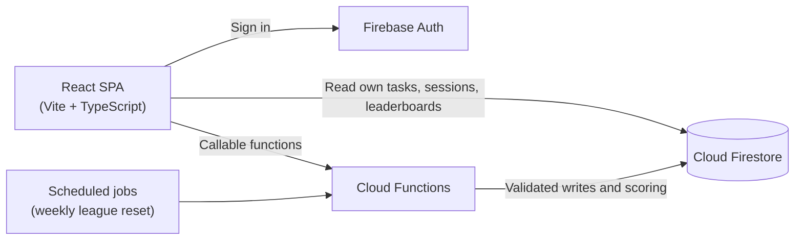

# Taskal

A focus-first productivity app: plan your tasks, run Pomodoro-style focus sessions, and climb weekly leagues. Focus sessions are scored on the server, so the leaderboard rewards real work rather than self-reported time.


## Features

- **Task planning**: create, edit and schedule tasks with date and time pickers.
- **Focus timer**: Pomodoro-style sessions with a 25-minute default focus block, 5-minute short breaks, and a 15-minute long break after every fourth block.
- **Integrity tracking**: during a session the app notices tab switches, window blur and paused time. Those signals are sent to a Cloud Function, which computes the integrity score on the server, so the client cannot simply report a perfect session.
- **Fair scoring**: a session counts only if it meets a minimum length, a completion ratio and an integrity threshold. Scored minutes are capped per day, and streaks boost points.
- **Weekly leagues**: players move through the league tiers, from Bronze up to Diamond. Every Monday at 00:05 UTC, the top 20% of each tier are promoted and the bottom 20% are demoted.
- **Leaderboards**: live weekly rankings across all players.
- **Accounts**: email and password sign-in, profile and settings pages, and account deletion.

## How it works



**Security model.** Firestore security rules let each signed-in user read only their own data. Clients cannot write tasks, sessions, points or leaderboard entries directly. All writes go through Cloud Functions. The Firebase web configuration is public by design, and the rules are what protect the data. See [`firestore.rules`](firestore.rules).

## Tech stack

| Layer | Technologies |
| --- | --- |
| Frontend | React 18, TypeScript, Vite, Tailwind CSS, shadcn/ui (Radix UI), React Router, Framer Motion |
| Backend | Firebase Authentication, Cloud Firestore, Cloud Functions (TypeScript), Luxon |
| Optional hardening | Firebase App Check with reCAPTCHA v3 |
| Tooling | Vitest, ESLint, Firebase CLI |

## Getting started

**Prerequisites:** Node.js 20 or newer, and a Firebase project with Email/Password sign-in, Cloud Firestore and Cloud Functions enabled.

```bash
git clone https://github.com/fAmesteR/Taskal.git
cd Taskal
npm install
cp .env.example .env    # fill in your Firebase web app config
npm run dev
```

`.env` is gitignored. Only the `VITE_FIREBASE_*` values are needed to run the app locally. Copy them from *Firebase console → Project settings → Your apps*.

### Scripts

| Command | Description |
| --- | --- |
| `npm run dev` | Start the development server |
| `npm run build` | Create a production build in `dist/` |
| `npm run preview` | Serve the production build locally |
| `npm test` | Run the unit tests with Vitest |
| `npm run lint` | Lint the project with ESLint |

## Deployment

```bash
npm run build
(cd functions && npm ci && npm run build)
firebase deploy --only firestore,functions,hosting
```

## Project structure

```
src/
  api/          Cloud Function clients for tasks and focus sessions
  components/   App components and shadcn/ui primitives
  hooks/        Pomodoro timer, focus guard and task store
  lib/          Firebase setup, settings and helpers
  pages/        Home, Leaderboard, Profile, Settings, Login and License
functions/src/  Cloud Functions: scoring, leagues, weekly reset and migrations
firestore.rules Firestore security rules
```

## Testing

Unit tests cover the Pomodoro phase logic, including break timing and the long-break cadence. Run them with `npm test`.

## License

Released under the [MIT License](LICENSE).
